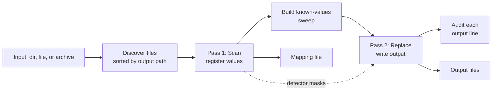

# Architecture

This page explains how `sas-log-sanitize` works internally and why it's built
that way. It's for contributors. For how to use the tool, start with the
[README](../README.md).

## Package layout

| Package | Responsibility |
|---|---|
| `cmd/sanitize` | CLI: flag parsing, config-file merging, modes, exit codes |
| `pkg/sanitize` | Public library API (`Sanitize`, `Reverse`, `AuditDirectory`, `Options`) |
| `internal/pipeline` | File discovery, the two passes, parallelism, the known-values sweep |
| `internal/detect` | Detectors, span claiming, prefilters, hand-written scanners |
| `internal/tokenize` | Token registry and mapping file |
| `internal/audit` | Audit rules and `_audit.txt` formatting |
| `internal/har` | Streaming HAR (JSON) sanitizing |
| `internal/archive` | Safe `.zip` and `.tar` extraction |
| `internal/io` | Encoding detection, line reading, and writing |
| `internal/profile` | Built-in profiles and the config-file schema |
| `internal/runlog` | `_runlog.txt` |

## Overview

## Two passes

Sanitizing runs two passes over the same ordered detector chain.
`Pipeline.walk` is shared by both passes, so they can't disagree about what
matched.

1. **Scan (`ScanLine`).** Every line of every file is read, and every match
   that is neither redacted nor claim-only is registered in the token registry
   (`internal/tokenize.Registry`). The complete value → token map exists before
   any output is written.
2. **Build the sweep (`Pipeline.EnableKnownValuesSweep`).** A
   `KnownValuesDetector` is built from every registered `USER` and `HOST`
   value, plus each host's short name, and appended as the last detector. See
   [Cross-detector consistency](#cross-detector-consistency).
3. **Replace (`ReplaceLine`).** Every line is read again. Each match is
   replaced with its token, or with `SECRET_REDACTED`, and written out. The
   audit scans each output line as it's produced.

**Invariant:** Pass 1 must finish before Pass 2 starts, and both must walk the
same detectors in the same order. Otherwise Pass 2 could meet a value that
Pass 1 never registered. The sweep only emits values that are already
registered, which is why it's safe to add for Pass 2 alone. See
`internal/pipeline/pipeline.go` and `run.go`.

## Inputs

`discoverFiles` (`internal/pipeline/discover.go`) turns the input into a list
of files sorted by output path. Token numbering depends on this order.

- **Binary files** are skipped, based on their extension or a sniff of their
  content. The sniff checks for a UTF-16 BOM *before* the non-printable-byte
  heuristic, because UTF-16 ASCII text is about half NUL bytes.
- **`*.gz` files** are read decompressed and written back gzipped under the
  same name.
- **Archives** (`.zip`, `.tar`, `.tar.gz`, `.tgz`), whether they're the input
  or inside it, are extracted by `internal/archive` into a `0700` temporary
  folder that is removed when the run ends. Their output goes under a folder
  named after the archive. Entries with absolute or `..` paths, symlinks,
  non-regular files, and archives inside archives are never written; they're
  reported as skipped. `--max-extract-mb` caps the total bytes extracted.

Every skipped file and its reason appear at the top of `_summary.txt`, in
`_summary.json`, and in the CLI's closing summary.

## Encoding

`internal/io` detects UTF-8, UTF-16LE, and UTF-16BE from a BOM. A file without
a BOM is treated as UTF-8, or as Windows-1252 if its first 64 KB isn't valid
UTF-8. `DetectSample` ignores a multi-byte character cut off at the end of the
sample. Invalid bytes pass through Go strings unchanged, so output bytes are
preserved either way. `TestLateWindows1252BytesRoundTrip` checks that a
Windows-1252 byte after the sample neither corrupts the output nor hides a
value. Line endings (CRLF or LF) and a missing final newline are reproduced
exactly.

## Streaming and parallelism

Files are streamed, never read whole. `openDecoded` reads a 64 KB sample to
detect the encoding, then feeds the rest through `ioenc.LineReader`. Peak
memory depends on the number of distinct registered values, not on file size.

Both passes run in parallel at two levels (`internal/pipeline/parallel.go`),
and the results are identical to a sequential run.

- **Across files.** Each file is scanned into its own registry
  (`forkForScan`). The per-file registries are merged in sorted-path order
  (`Registry.Merge`). Numbering is per category, so the tokens are exactly
  what a sequential scan would assign.
- **Within a file.** In `processChunks`, a single reader goroutine splits the
  file into chunks of lines for the workers, and the results are emitted in
  input order. State that spans lines, such as whether a line is inside a PEM
  key block, is computed by the reader, never by the workers.

A semaphore caps CPU-bound work at `--workers`. Each file allows four chunks
per worker in flight, so one slow chunk (for example, on an efficiency core)
doesn't stall the in-order emitter. Audit findings and counts are combined in
input order, so `_audit.txt` and `_summary.*` are the same for any worker
count.

## Performance techniques

| Technique | Where | Safety check |
|---|---|---|
| **Prefilters.** `MightMatch` rejects lines cheaply, for example a line with no `@` can't hold an email. Credential and secret rules are gated on a required keyword. | `detect.Prefilter` | `TestPrefiltersAreConservative`, `TestAuditGatesAreConservative` |
| **Hand-written scanners** replace the regexes that run on nearly every line: dotted quads, UUIDs, IPv6 candidates, CAS tickets, credential query parameters, version keywords, FQDNs, MACs, and URLs. The regexes stay in the source as the reference. | `internal/detect/scanners.go`, `internal/audit/scanners.go` | `TestScannersMatchRegexps`, `FuzzScanners`, `TestAuditScannersMatchRegexps`, `FuzzAuditScanners` |
| **Sweep index.** Known values are indexed by their first two lowercased bytes, so most word starts cost one bit test. | `KnownValuesDetector` | `TestKnownValuesIndexMatchesReference` |
| **Pass 2 masking.** See below. | `ReplaceLineMasked` | `TestMaskedReplaceMatchesFullWalk` |

### Pass 2 masking

Detectors are pure functions of the line. A detector that found nothing on a
line in Pass 1 therefore finds nothing on that line in Pass 2.

Pass 1 records a `DetectorMask` for each line, with one bit per detector that
returned a candidate. It writes the masks to a per-file sidecar in the run's
temporary folder: for each chunk, the line count, a chunk hash, and one uvarint
per line. Pass 2 then runs only the detectors set in the mask, plus the sweep.

If a chunk's line count or hash differs from Pass 1, or the sidecar can't be
read or written, every detector runs. The fallback never runs *fewer*
detectors. Detectors past index 31 aren't tracked in the 32-bit mask and always
run.

To profile a run, pass `--cpuprofile cpu.prof`, then run
`go tool pprof -top <binary> cpu.prof`.

## HAR files

`*.har` files, and `*.json` files whose top-level key is `"log"`, go through
`internal/har` instead of the line pipeline. This includes `*.har.gz`. The
JSON is streamed token by token, key order and number formatting are
preserved, and the output is indented.

- Credential headers and all cookie values are redacted whole.
- `queryString` and `postData.params` values are redacted when the parameter
  name is a credential.
- Response bodies are dropped, unless `--keep-har-bodies` is set, in which
  case they're scanned.
- Timings, sizes, status codes, methods, and header names are untouched.
- Every other string goes through the normal detector walk.

Only small name/value entries are parsed whole. Memory is bounded by the
largest single string. Pass 1 decides for each file whether the HAR parses.
One that doesn't, such as a truncated file, falls back to line processing in
*both* passes, so Pass 2 never writes half a JSON document.

## Token registry

`Registry` assigns sequential tokens per category (`HOST_001`, `HOST_002`, …)
in the order values are first seen. Within a run, the same value always gets
the same token. Every run starts a fresh registry, and keeping tokens
consistent across runs is a deliberate non-goal.

`HOST`, `DOMAIN`, and `EMAIL` values are case-insensitive, and the mapping file
keeps the first spelling seen. `USER` values are case-sensitive. Categories can
have several parts (`IPV4_PRIV_001`); reverse mode and the audit's
token-shape checks accept that form.

## Span claiming

`detect.LineState` tracks which byte ranges of the current line have been
claimed. The pipeline enforces this centrally. Each detector returns its
candidates without regard to other detectors, and `walk` accepts a candidate
only if it doesn't overlap a span that's already claimed, in chain order.

Any overlap, even a partial one, rejects the whole candidate. The tool never
matches around a claimed sub-span. This keeps replacement deterministic, at
the cost of sometimes leaving a longer match unclaimed. Two design rules
follow from it:

- Inside `CredentialsDetector`, free-text values (authorization and cookie
  headers) and per-parameter URL and form values are matched *before* the
  generic `key=value` rules. Otherwise a narrower rule could claim a fragment
  and the whole value would be dropped.
- When a credential rule claims a query-string value, the URL detector skips
  that URL. The host is then tokenized by the FQDN or IPv4 detector. This is
  why `--url-mode whole` doesn't replace URLs that contain credentials.

## Detector order

The chain (`pipeline.DefaultDetectorChain`) runs in this order:

1. UUID (claim-only), so nothing matches inside a UUID.
2. Credentials and secrets (full redaction).
3. Identity, network, and path detectors, from broadest and most sensitive to
   narrowest.
4. The hostlist substring detector.
5. The known-values sweep (Pass 2 only).

The UUID detector doesn't claim a UUID that is the value of a credential (a
CSRF token, a session cookie, `"access_token":"<uuid>"`). When a line contains
a UUID, the detector checks the credential and secret rules and leaves UUIDs
inside their spans alone. Claiming them would make the credential rules skip
them, and the secret would leak.

The [Detectors reference](reference/detectors.md) lists the full order.

## Cross-detector consistency

Three mechanisms give a real value the same token everywhere it appears.

- **Hosts inside URLs and UNC paths.** In `host` URL mode, the URL detector
  tokenizes the host as `HOST` directly. In `whole` mode, and for UNC paths, the
  whole value becomes one token and the embedded host is registered as `HOST`
  in Pass 1 as well (`pipeline.registerEmbeddedHost`).
- **The known-values sweep.** Registered `USER` and `HOST` values are replaced
  everywhere in Pass 2, as whole words and regardless of case. A host's first
  label is swept with the full name's token. Values that are too short, purely
  numeric, common words, or generic account names are excluded, as are short
  names from two-label domains. Matching is a hash lookup at each word start,
  because an alternation of thousands of case-insensitive values is far too
  slow.
- **Case-insensitive tokens** for hosts, domains, and email addresses.

A host that only ever appears as a short name is caught only by `--hostlist`.

## Audit pass

`internal/audit.Scanner` re-scans the output for anything that still looks
like PII. It's a second line of defense, not a guarantee.

- **Shared validation.** Rules call the same helpers as the detectors (for
  example `detect.IsValidFQDN` and `detect.LooksLikeVersionString`), so the
  audit doesn't flag what a detector chose to leave.
- **`known-original-value`.** This rule searches for every original value in
  the mapping. It catches leaks that no shape rule recognizes, and any future
  detector regression.
- **Severity.** High rules are tuned for few false positives, because any High
  finding exits `1`. Medium rules are deliberately broad, because a missed leak
  costs more than a false alarm, so they fail a run only under `--strict`.

For the rule list, see [Output files](reference/output-files.md#audit-rules).

## Profiles

`internal/profile` defines detection metadata for each log format: file-name
patterns, a first-line pattern, and extra internal TLDs. Today only the TLDs
are used, merged across the selected profiles into one FQDN detector for the
whole run. Selecting different detectors for each file is not implemented yet.
See the scope note in `pkg/sanitize/doc.go`.
